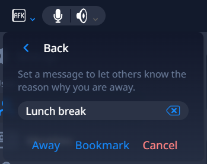
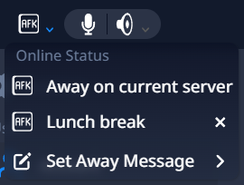

# Away Message Bookmarks #
Away Message Bookmarks is an unofficial addon for TeamSpeak 6 that adds the option to bookmark any away message for later reuse.

## Usage ##
1. Create a new bookmark by clicking the new "Bookmark" button in the away message modal:  
  
2. Select previously created bookmarks in the AFK dropdown:  
  

## Installation ##
> [!NOTE]
> * Depending on your installation directory you may need elevated permission privileges
> * The installation process needs to be repeated after each TeamSpeak update

### Installer ###
Installation steps:
1. Download the TS6AddonInstaller for your operating system from [here](https://github.com/Exopandora/TS6AddonInstaller/releases)
2. Start the installer
3. Select your TeamSpeak installation directory
4. Select "Away Message Bookmarks"
5. Click on "Install"

## Building from source ##

### Requirements ###
1. A recent Node.js installation

### Compiling ###
Clone the repository and run the following commands in the root directory of this repository:
```shell
npm install
npm run build
```
The resulting archive can be found in the `build/dist` directory.
